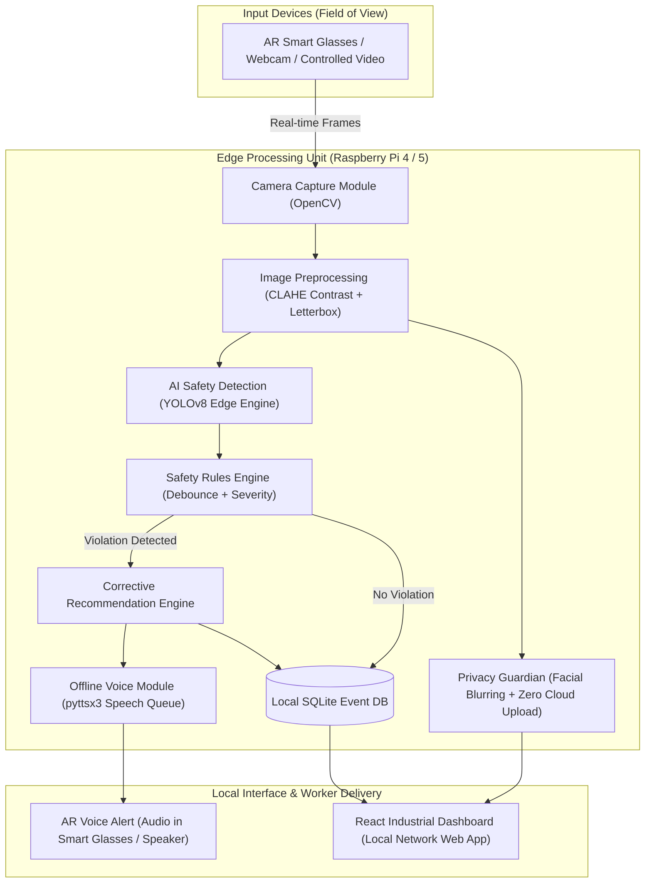

# Edge-Enabled Privacy-Preserving System for Construction Workspace Management
## System Architecture & Technical Specification

Based on the Mini-Project Synopsis submitted to the Department of Electronics & Communication Engineering and Department of Computer Science & Engineering, **Siddaganga Institute of Technology (SIT), Tumakuru**.

---

## 1. Executive Summary & Core Concept

Construction workspaces expose workers to severe hazards: heavy machinery, suspended loads, high elevations, and missing Personal Protective Equipment (PPE). Conventional safety monitoring depends on manual inspection by safety supervisors, which is labor-intensive, intermittent, and error-prone.

While cloud-based computer vision exists, streaming 24/7 video from construction sites to external cloud servers introduces:
1. **Severe Privacy Violations**: Worker facial identities, biometric data, and activities are continuously transmitted outside the worksite boundary.
2. **Bandwidth & Latency Constraints**: High-bandwidth cellular uplink is unreliable on active job sites, causing alert lags that render immediate hazard warnings useless.
3. **Network Dependence**: Loss of connectivity disables safety monitoring entirely.

This system provides a **Local Edge-First, Privacy-Preserving Architecture**:
- Video capture via AR/VR smart glasses or webcams.
- Real-time frame processing inside the local RAM of an on-site Raspberry Pi edge unit.
- Local AI object detection and spatial PPE verification.
- Immediate localized native-language voice alerts delivered in real-time.
- Local SQLite database logging of minimal necessary event metadata (zero raw video stored or transmitted).

---

## 2. System Architecture Diagram

---

## 3. End-to-End System Flowchart (Figure 2 in Synopsis)

1. **Initialization**: Initialize Camera, Raspberry Pi, SQLite Database, AI Model, Voice Worker Thread, and REST API.
2. **Frame Capture**: Ingest frames from AR/VR smart glasses or site camera.
3. **Preprocessing**: Apply adaptive contrast enhancement (CLAHE) to handle intense outdoor sun or dim scaffold shadows.
4. **AI-Based Detection**: Detect workers, hard-hats, safety vests, and spatial bounding boxes.
5. **Safety Violation Check**:
   - If worker lacks helmet: Flag `MISSING_HELMET` (High Severity).
   - If worker lacks vest: Flag `MISSING_VEST` (Medium Severity).
   - If worker enters excavator swing zone: Flag `RESTRICTED_ZONE_INTRUSION` (Critical Severity).
6. **Alert Debounce Check**:
   - If violation was alerted within the cooldown period (e.g. 6s), suppress audio repetition to avoid cognitive alarm fatigue.
   - If new violation or cooldown expired:
     - Generate corrective recommendation.
     - Synthesize native-language voice alert.
     - Push alert to worker interface.
     - Store minimal event log to SQLite.
7. **Privacy Masking**: Apply automated Gaussian blur over detected facial regions before any frame is made available to the local preview stream.
8. **Loop**: Continue monitoring until operator issues stop command.

---

## 4. Hardware-Dependent Components vs Hardware-Agnostic Modules

| Component | Hardware-Dependent Aspect | Development / Fallback Strategy |
| :--- | :--- | :--- |
| **Camera Ingestion** | V4L2 USB camera / MIPI-CSI Raspberry Pi Camera Module | Supports OpenCV DirectShow (`CAP_DSHOW`), Video file uploads, and built-in synthetic worksite generator. |
| **AI Inference** | ARM Cortex-A72/A76 CPU or Edge TPU accelerator | PyTorch CPU / YOLOv8 nano / OpenCV DNN ONNX runtime with heuristic fallback. |
| **Voice Output** | 3.5mm audio jack / Bluetooth AR Smart Glasses speaker | Offline `pyttsx3` with background threading and fallback logging. |
| **Local Storage** | MicroSD card / NVMe HAT on Raspberry Pi | Standard zero-config SQLite database (`construction_safety.db`). |

---

## 5. Privacy Safeguards & Compliance Matrix

| Requirement | Implementation Mechanism | Verification Result |
| :--- | :--- | :--- |
| **Zero Cloud Video Upload** | REST API and WebSocket only operate on local LAN (`localhost` / `192.168.x.x`). No outbound network calls. | **VERIFIED (COMPLIANT)** |
| **No Raw Video Storage** | Frames are processed in volatile memory (RAM buffers) and discarded. No MP4/AVI write routines exist. | **VERIFIED (COMPLIANT)** |
| **Facial Anonymization** | Bounding box head-region Gaussian blurring is applied to all preview frames. | **VERIFIED (COMPLIANT)** |
| **Minimal Event Logging** | Database records only contain timestamp, violation code, confidence, and anonymized worker IDs. | **VERIFIED (COMPLIANT)** |
| **Configurable Data Retention**| Automatic retention purge service cleans records older than configured days (default 14 days). | **VERIFIED (COMPLIANT)** |
